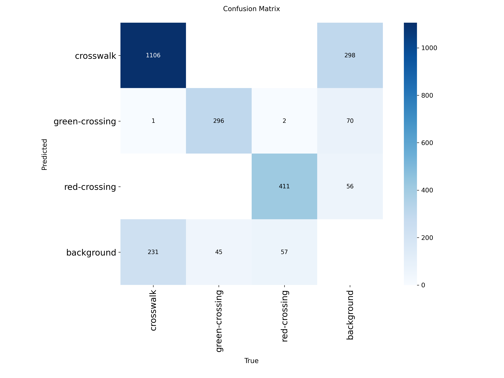
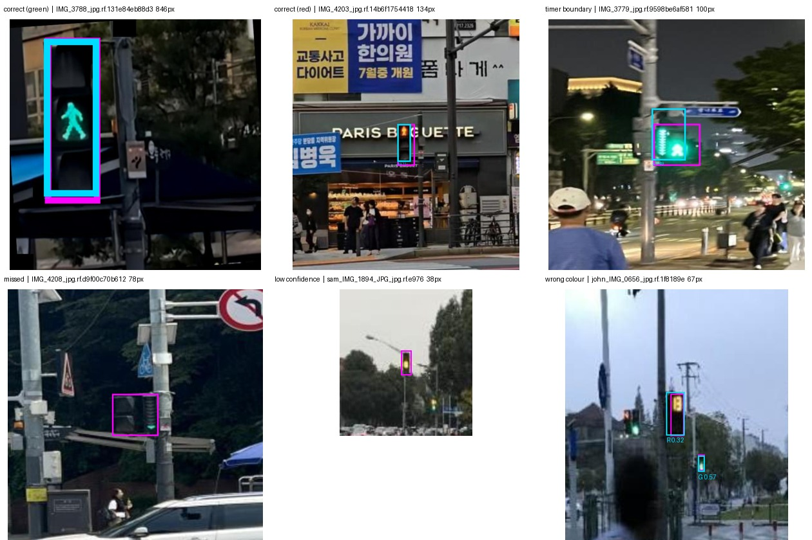

# Crosswalk and pedestrian-signal detection (v1)

A single detector for crosswalks and red/green pedestrian signals in eye-level pedestrian images. Two questions guide the evaluation:

1. How well does the detector generalize to a walk or intersection it has not seen?
2. When a pedestrian signal is red, how often does the detector report green?

**v1 result** (YOLO26s, 640 px, 3 seeds, test evaluated once on 881 images): mAP50 **0.870 ± 0.006**, mAP50-95 **0.520 ± 0.004**; red reported as green on **0.36%** of red test signals.

## Classes and annotation rules

| ID | Class | Box |
| ---: | --- | --- |
| 0 | `crosswalk` | One tight box per crosswalk around its visible stripes. |
| 1 | `green-crossing` | Signal head with the green walking-person lamp lit. |
| 2 | `red-crossing` | Signal head with the red standing-person lamp lit. |

- **Signals:** the lit lamp sets the class. The box covers the whole head (both lamp cells) plus any countdown timer attached to it, even when dark; poles and brackets are excluded. Signals whose lit color cannot be seen (e.g. at night or far away) are intentionally left unlabeled, so detections on them count as false positives. This is a conservative choice: the detector should not assert a color a person could not verify.
- **Crosswalks:** a partially occluded crosswalk gets one box; crosswalks in different directions or split by a median get separate boxes. A distant crosswalk is labeled only if at least three stripes are distinguishable. Lane markings, stop lines and curbs are excluded. Full rules: [`docs/labeling_rules.md`](docs/labeling_rules.md).

## Dataset

Annotated in Roboflow, exported in YOLO format. Raw images are not included in this repository. The final dataset **ds_v4** has **8,291 images (6,247 train / 1,163 valid / 881 test)**.

Image counts by filename family (ds_v4). A prefix alone does not establish the original photographer or dataset, because some families occur in several collections.

| Source or collection | Filename family | Train | Valid | Test |
| --- | --- | ---: | ---: | ---: |
| Own phone photos, Korea | `IMG_` (own) | 0 | 25 | 48 |
| Roboflow Universe, *Pedestrian Traffic Lights Final* (China subset) | `IMG_` (1750–2223) | 257 | 0 | 0 |
| Roboflow Universe, *Crosswalk&pedestrian light* | `KakaoTalk_20250331_` | 171 | 0 | 0 |
| Roboflow Universe, *Pedestrian Traffic Lights Final* | `KakaoTalk_20230802/03_` | 3 | 27 | 0 |
| KakaoTalk images, origin unconfirmed | `KakaoTalk_2022…`, `_20241120_`, `_202607…` | 3 | 17 | 39 |
| AI Hub pedestrian data, Korea | `MP_SEL_`, `MP_KSC_` | 1,499 | 321 | 324 |
| AI Hub stereo data, Korea | `ZED*` | 368 | 95 | 81 |
| PTL dataset, China | `heon_`, `john_`, `sam_` | 2,608 | 572 | 242 |
| Mixed web images (mostly close-ups), origin partly unconfirmed | `gpl-`, `Cross`, `Strisce`, numeric | 1,173 | 105 | 139 |
| Other families | various | 165 | 1 | 8 |
| **Total** | | **6,247** | **1,163** | **881** |

Box counts:

| Split | Images | Crosswalk | Green | Red |
| --- | ---: | ---: | ---: | ---: |
| Train | 6,247 | 7,996 | 3,022 | 2,259 |
| Valid | 1,163 | 1,636 | 594 | 456 |
| Test | 881 | 1,338 | 341 | 470 |

**Sources.** AI Hub collections are provided by the National Information Society Agency (NIA), Korea. The PTL dataset comes from the [ImVisible](https://github.com/samuelyu2002/ImVisible) project (LytNet). The two Roboflow Universe collections are listed as CC BY 4.0: [Pedestrian Traffic Lights Final](https://universe.roboflow.com/test-xi95g/pedestrian-traffic-lights-final) and [Crosswalk&pedestrian light](https://universe.roboflow.com/cap-8nhra/crosswalk-pedestrian-light). Original attribution for several web-image families is unresolved.

## Split

A single walk yields many near-identical photos of the same signal, so images are split by **group**, not individually. A group joins duplicates and augmented copies, frames from the same video or folder, nearby numbered frames (gap ≤ 30), same-day KakaoTalk clips within 30 minutes, and near-duplicates found by hashing. Groups are assigned with source stratification (`src/data/resplit_groups.py --gap 30 --stratify-source`). Large groups push the observed ratio (~75/14/11) away from the 70/15/15 target.

<details>
<summary>Split history</summary>

- **October:** an image-random split put consecutive frames and augmented copies on both sides. Its results were discarded.
- **Nov 14–20:** removed 533 cross-export duplicates, grouped related images and removed training images that overlapped valid/test.
- **Nov 20 audit:** filename-sequence and hash checks showed that most valid/test images still had training neighbours. A first re-split (`ds_v2`) produced two chained groups of 957 and 859 images and only 28% of AI Hub in train, so it was abandoned. A source-stratified re-split gave `ds_v3` (moving 3,715 images), and model selection was redone on it.
- **Nov 20, before test:** removed `rpl` (watermarked stock-video preview, 572 frames) from all splits for licensing and data-quality reasons, giving `ds_v4` (8,863 → 8,291 images).

</details>

### Test subsets

`full` is the primary benchmark. Four subsets were fixed before the test run as sensitivity checks; all model and threshold choices used validation only.

| Subset | Images | Definition |
| --- | ---: | --- |
| **`full`** | **881** | All test images |
| `no_seq` | 841 | Without images flagged by the filename-sequence audit |
| `no_aug` | 823 | Without detected offline-augmented copies (one copy per original kept) |
| `clean` | 789 | Both `no_seq` and `no_aug` |
| `korea` | 492 | Korean sources only (AI Hub, ZED, own photos, KakaoTalk) |

## Training and model selection

Ultralytics 8.4.216, COCO-pretrained weights, 640 px, 50 epochs, batch 16, Colab NVIDIA L4 (~54 min/run); evaluation on T4. Online augmentation uses the Ultralytics defaults with no overrides: mosaic (off for the last 10 epochs), random scale ±0.5 and translate 0.1, horizontal flip 0.5, no vertical flip, and HSV jitter (hue 0.015, saturation 0.7, value 0.4). Hue jitter is small (about ±5°); disabling it is left as a December ablation.

1. **Architecture (ds_v3, seed 0, valid):** YOLO26s mAP50 0.864 > YOLO26n 0.855 > YOLO11s 0.837. YOLO26s also had the highest green recall and was selected.
2. **Seeds (ds_v4):** YOLO26s retrained with seeds 0, 1, 2; results are reported as mean ± std. Model size 9.95M parameters and 22.7 GFLOPs as trained (9.47M and 20.8 GFLOPs after layer fusion for inference). On a Colab T4 (FP32, batch 1, 640 px), per-image time on 200 validation images is 12.2 ms per image (1.6 ms preprocessing, 9.4 ms inference, 1.2 ms postprocessing), about 80 images per second.

**Input resolution.** Higher resolution did not help: missed signals had a median height of 36 px, and a 1280 px model (seed 0) lowered green and red recall (0.828 → 0.815, 0.874 → 0.868) at 6.6× the inference time, failing a pre-set validation rule, so it was not tested.

## Evaluation protocol

- **Detection:** mAP50, mAP50-95, and per-class precision/recall/AP from Ultralytics validation (predictions kept down to conf 0.001; precision and recall taken at the confidence that maximizes F1). The colour metrics below use a fixed conf ≥ 0.25, so the two sets of recall values are not directly comparable.
- **Signal color:** each annotated signal is scored separately. Among signal predictions (either colour) with confidence ≥ 0.25 and IoU ≥ 0.50 with that signal, the highest-confidence one decides the result: correct colour, wrong colour, or miss if none qualifies. Matching is not one-to-one: one prediction can be counted for two overlapping annotated signals, which is rare because signal heads seldom overlap. A localization mismatch (IoU < 0.50) is counted as a miss. **`red_as_green`** = red signals scored green ÷ all red signals.
- **Test:** configuration, thresholds and rules were fixed on validation; all three seeds were evaluated on test in one round.

## Results

Unless marked otherwise, values are the mean ± standard deviation over seeds 0, 1 and 2. Values marked † are from seed 0 only.

**Detection**

| Metric | Valid (1,163) | Test `full` (881) |
| --- | ---: | ---: |
| mAP50 | 0.900 ± 0.004 | 0.870 ± 0.006 |
| mAP50-95 | 0.600 ± 0.004 | 0.520 ± 0.004 |
| Crosswalk recall | 0.824 ± 0.002 | 0.770 ± 0.007 |
| Green recall / AP50 | 0.826 ± 0.007 / 0.870 ± 0.006 | 0.850 ± 0.004 / 0.851 ± 0.010 |
| Red recall / AP50 | 0.877 ± 0.005 / 0.923 ± 0.006 | 0.861 ± 0.004 / 0.883 ± 0.009 |

**Signal color** (conf ≥ 0.25, IoU ≥ 0.50; denominators: valid 594 green / 456 red, test 341 / 470)

| | Valid | Test `full` | Test `korea` |
| --- | ---: | ---: | ---: |
| Green miss | 12.2 ± 1.1% | 12.2 ± 0.3% | 16.9 ± 0.9% |
| Red miss | 9.9 ± 1.0% | 12.0 ± 0.3% | 14.0 ± 0.6% |
| `red_as_green` | 0.44% (2/456 in each seed) | 0.36 ± 0.12% (2, 2, 1 of 470 for seeds 0, 1, 2) | 0% in each seed |
| Green as red | not reported | 0% (0/341 in each seed) | not reported |



*Confusion matrix (counts), test `full` (881 images), seed 0, confidence ≥ 0.25, IoU ≥ 0.50, Ultralytics one-to-one matching. Columns are ground truth. Red and green are almost never swapped (2 red→green, 0 green→red). Misses (bottom row) and false positives (right column: 298 crosswalk, 70 green, 56 red) dominate the errors. Diagonal counts differ slightly from the recall in the tables because Ultralytics matches boxes class-agnostically.*

On test, every `red_as_green` case comes from two images (`john_IMG_1009`, `sam_IMG_1301`). Their ground truth is suspected to be wrong, but it was not re-checked or changed after the test run, so the measured value is reported as is.

**Test subsets**

| Subset | mAP50 | mAP50-95 |
| --- | ---: | ---: |
| `full` | 0.870 ± 0.006 | 0.520 ± 0.004 |
| `no_seq` | 0.874 ± 0.005 | 0.519 ± 0.005 |
| `no_aug` | 0.875 ± 0.004 | 0.524 ± 0.004 |
| `clean` | 0.877 ± 0.003 | 0.523 ± 0.004 |
| `korea` | 0.862 ± 0.003 | 0.492 ± 0.007 |

**Reading the results**

- **Q1, generalization:** removing sequence-flagged or augmented images changes mAP50 by less than 0.01. No large difference is observed on the subsets checked, but this does not rule out leakage that the audits did not detect. The validation-to-test drop is larger in mAP50-95 (0.600 → 0.520) than in mAP50 (0.900 → 0.870). Together with the validation failure analysis below, this suggests that localization error is one likely cause. The Korean subset is the hardest (mAP50-95 0.492; green miss 16.9%).
- **Q2, red reported as green:** 0.36% of red test signals (5 of 1,410 over three seeds). All cases come from two images with suspected label errors; until those labels are re-checked, how much is model error and how much is label error is not known. Missing a signal (~12%) is far more common than reporting the wrong color.
- **Validation failure breakdown** † (seed 0, 1,050 signal boxes, conf ≥ 0.25): 914 correct, 70 localization mismatches (IoU < 0.50, mostly at the countdown-timer boundary), 23 low-confidence detections, 36 true misses (3.4% of signals) and 7 wrong colours. Of the missed signals, 51% were localization mismatches, 43% were true misses or low-confidence detections, and 5% were colour errors. Here a prediction with IoU 0.10–0.50 counts as a localization mismatch, and one with IoU ≥ 0.50 only at confidence 0.05–0.25 counts as low-confidence. All seven colour errors come from the PTL family (`john_`, `sam_`); one is a known label error (`sam_IMG_1498`). Signals under 20 px are only 2% of boxes, green signals of 20–40 px have recall 0.763, and KakaoTalk-family images are the weakest source.



*Representative validation cases † (seed 0, confidence ≥ 0.25). Pink = ground truth, cyan = prediction (only predictions ≥ 0.25 are drawn). Top: correct green and red detections, and a countdown-timer boundary mismatch where the predicted box covers a different part of the head than the label (IoU < 0.50). Bottom: a backlit signal that is missed, a signal detected only below confidence 0.25, and a colour disagreement. In the last panel the model predicts red (0.32) for a signal labeled green, and the lit lamp appears red, so this is most likely a label error rather than a model error. Own photos except the bottom-middle and bottom-right panels (PTL); no AI Hub images are shown.*


## Reproducing

```bash
pip install ultralytics==8.4.216            # Python 3.10+, CUDA GPU recommended
```

```
src/data/    convert_datasets.py (AI Hub -> YOLO), resplit_groups.py (group-aware split)
src/audit/   leak_followup.py, find_cutout.py, make_eval_subsets.py (split and test-subset checks),
             light_miss_audit.py, old_rule_light_check.py (signal-miss and label-rule audits, valid only)
src/eval/    v1_eval.py (signal colour / miss rates), valid_by_origin.py
notebooks/   train_eval_v1.ipynb (3-seed training, one-time test evaluation)
data/        split documentation (no images or labels)
docs/        labeling_rules.md
figures/     figures used in this README
```

1. **Data.** Images are not redistributed. Download the sources listed under Dataset (AI Hub requires approval), annotate with the rules above, export YOLO format, then group and split:
   `python src/data/resplit_groups.py <export_dir> --out ds_v3 --gap 30 --stratify-source` and remove `rpl*` images from all splits to obtain `ds_v4`. [`data/split_manifest.csv`](data/split_manifest.csv) lists the exact file-to-split assignment used for v1.
2. **Train** (one seed): `yolo detect train model=yolo26s.pt data=ds_v4/data.yaml imgsz=640 epochs=50 batch=16 seed=0`. The notebook [`notebooks/train_eval_v1.ipynb`](notebooks/train_eval_v1.ipynb) runs seeds 0–2 (`MODE='train'`) and the one-time test evaluation (`MODE='test'`) on Colab, Kaggle or locally.
3. **Evaluate:** `yolo detect val model=best.pt data=ds_v4/data.yaml split=test imgsz=640` for mAP, and `python src/eval/v1_eval.py --weights best.pt --data-root ds_v4 --split valid --out eval/` for signal colour and miss rates. Use `split=valid` until the configuration is final.
4. **Predict:** `yolo detect predict model=best.pt source=<image_or_folder> imgsz=640 conf=0.25`.

**Weights.** The trained `best.pt` (seed 0) is released with this repository under AGPL-3.0, the Ultralytics licence. Training images and labels are not redistributed; according to the [AI Hub FAQ](https://aihub.or.kr/aihubnews/faq/list.do) (checked Nov 21, 2026), sharing a trained model without the source images is permitted.

Download: [`walk-assist_v1_yolo26s_640_s0.pt`](../../releases/tag/v1) (YOLO26s, 640 px, seed 0, Ultralytics 8.4.216; SHA-256 `082ddc681d865ce42528f2492b7bcb46bd581d8ea1975feae45fef3cfcf10d9a`).

## Limitations

- **Prior test exposure.** An earlier model was evaluated on Nov 15 on a test set that partly overlaps the current one. No labels or settings were changed in response.
- **Grouping is heuristic.** Filename and hash rules cannot guarantee distinct intersections, and boxes repeat within a walk (341 green test boxes from 130 groups), so the effective sample is smaller than the box count.
- **Source coverage.** Test has one `heon_` image and no `gpl-` images, so no per-family AP is reported for them. Attribution for some web-image families is unresolved.
- **Label inconsistencies found after testing.** Failure review shows that some signal heads with an attached countdown timer were boxed around the lit lamp only (rule v1), and some signals for a perpendicular crossing were left unlabeled. These inflate localization misses and false positives. Labels were not changed for v1; they are queued for the v2 relabel.
- **Small sample of color errors.** `red_as_green` rests on two images, so the 0.36% is not a reliable rate estimate, only an indication that wrong-color reports are rare on this test set.
- **Not a safety system.** v1 is a research prototype evaluated on still images, not a validated aid for crossing decisions.

## Next (December)

- Resolution: training at 1280 did not pass the pre-set rule (above), so tiling is deprioritised in favour of fixing the countdown-timer box labels.
- Green confidence threshold vs `red_as_green` trade-off curve on validation.
- Re-label known training errors; add designs similar to `rpl`; review the two suspected test GT errors and re-freeze the test set for v2.
- Countdown and text reading (OCR).
